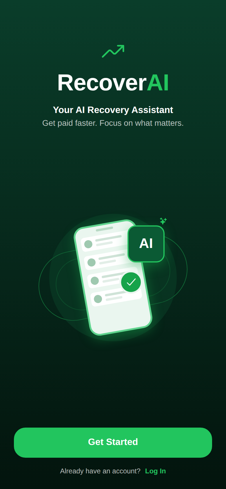
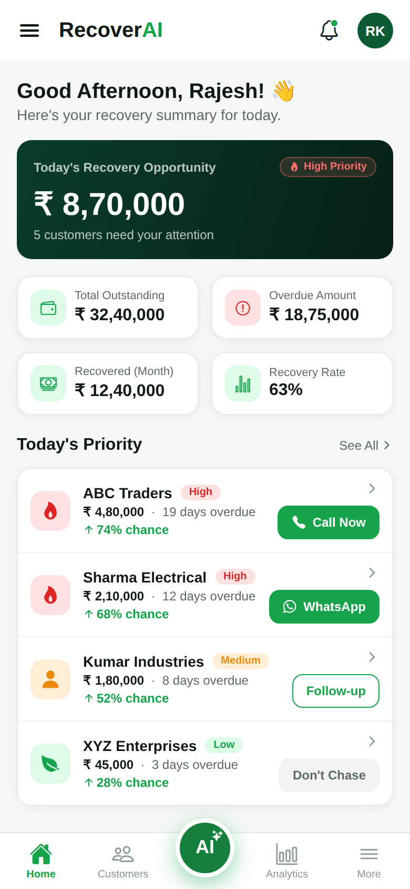

# RecoverAI

AI-powered collections and recovery assistant (React Native + Expo, TypeScript).

## Run it

```bash
npm install
npm run web        # browser preview
npm start          # Expo dev server (scan QR with Expo Go)
npm run typecheck
```

## Structure

```
src/
  app/                  # Expo Router routes
    index.tsx           # Splash
    (tabs)/             # Bottom tabs: home, customers, ai, analytics, more
    customer/[id].tsx   # Customer detail (drill-in, placeholder)
    conversation/[id].tsx
  components/           # Shared UI: Card, RiskBadge, Button, IconTile, TabBar
  theme/                # Colors, spacing, radius, typography, shadows
  data/mock.ts          # Static mock data until the import flow lands
  utils/format.ts       # Indian-format rupee helper
```

## Screens

| Splash | Dashboard |
| --- | --- |
|  |  |

Built so far: Splash, Home/Dashboard, navigation shell. Coming next: AI Recovery Plan, Customer List/Detail,
AI Conversation, Analytics, More/Settings, and the 6-step data import flow.
